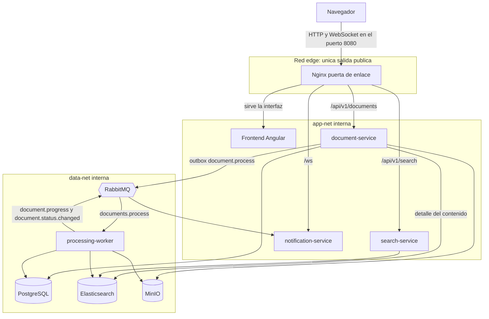
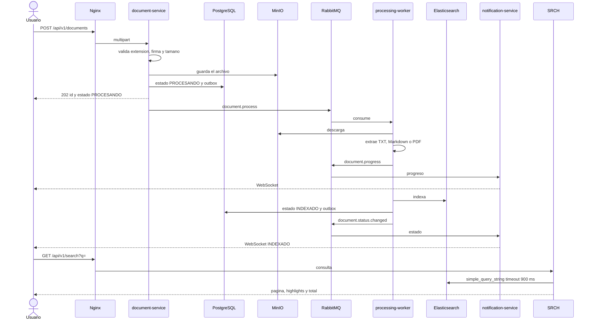

# Arquitectura de TechDocs

Plataforma de carga, indexación y búsqueda de documentación técnica. El rango de 400 ms a 1 s se trata como SLA de latencia máxima: la búsqueda debe responder con p95 menor o igual a 1 s. Elasticsearch suele quedar por debajo de 400 ms; Prometheus alerta si el p95 supera 1 s.

El detalle de despliegue está en `docs/arquitectura-plataforma-documentacion-tecnica.md`. Este documento cubre el flujo, la separación de redes, las decisiones, el tiempo real y la escalabilidad.

## 1. Diagrama de arquitectura y flujo

Cada servicio es un proceso aparte. Entre ellos comparten redes internas de Docker, sin puerto publicado. La única salida pública es Nginx: el navegador carga el frontend y habla con la API solo a través de esa puerta de enlace.

Flujo de una carga hasta que el documento se puede buscar:

## 2. Separación de servicios y frontera de red

La plataforma no es un solo proceso con módulos. Carga, búsqueda, procesamiento, aviso en tiempo real y telemetría son contenedores distintos, con su propio ciclo de vida. Un fallo o un pico en la indexación no comparte memoria con la consulta que debe responder en menos de un segundo.

Esos contenedores sí comparten red, pero es una red privada. `app-net`, `data-net` y `obs-net` están declaradas con `internal: true`: no tienen salida a internet y ningún servicio de esas redes publica un puerto al host. Dentro de ellas se resuelven por nombre de Docker (`postgres`, `elasticsearch`, `rabbitmq`, `minio`) y ahí circula la información que no debe salir: URLs con usuario y contraseña, el archivo en el bucket, el texto extraído, los eventos del outbox y las métricas. El worker ni siquiera está en `app-net`; solo ve `data-net`, así que la puerta de enlace no tiene ruta hacia el proceso que parsea PDF.

La salida pública es una sola. Nginx vive en la red `edge` y es el único componente de la aplicación que publica un puerto (`8080`). El frontend Angular no tiene puerto en el host: permanece en `app-net` y se vuelve visible porque Nginx lo sirve. El navegador no elige a qué servicio conectarse. Pide la interfaz, `/api/v1/documents`, `/api/v1/search` o `/ws`, y la puerta de enlace es quien cruza de la red pública a la red interna.

Ese cruce es la estrategia de seguridad. Los servicios comparten secretos y estado entre ellos, en la red interna. Nginx es el único punto donde una parte de ese trabajo privado se entrega hacia afuera, y solo en las rutas que el gateway define: la página, la API de documentos, la búsqueda y el WebSocket. Ahí se aplican el rate limit, el tope de cuerpo, los timeouts y las cabeceras (`X-Content-Type-Options`, `X-Frame-Options`, `Referrer-Policy`). Las credenciales de PostgreSQL, Elasticsearch, RabbitMQ y MinIO no viajan en esa respuesta. Grafana también está en `edge`, pero su puerto queda atado a `127.0.0.1`.

## 3. Justificación de decisiones

| Pieza | Elección | Por qué cumple el SLA |
|---|---|---|
| API | Java 21 y Spring Boot 3.4, un proceso por caso de uso | La búsqueda no comparte CPU ni heap con la carga ni con el parseo de PDF. |
| Contrato HTTP | `202` en la carga, `200` en la búsqueda | El usuario no espera la extracción. El tiempo medido del SLA es solo la consulta. |
| Base de datos | PostgreSQL | Fuente de verdad de metadatos, estado, intentos y outbox. No ejecuta `LIKE` ni participa en la búsqueda. |
| Motor de búsqueda | Elasticsearch 8, analizador en español | Índice invertido, `simple_query_string`, highlighting y paginación. El índice excluye el cuerpo completo del `_source` en la lista de resultados. |
| Timeout de búsqueda | 900 ms en la query y 2 s en Nginx | Si el motor se acerca al segundo, corta y puede devolver resultados parciales marcados. La alerta de Prometheus usa el p95 de `/api/v1/search`. |
| Archivos | MinIO compatible con S3 | El binario no entra en PostgreSQL ni en Elasticsearch. El índice solo guarda el texto extraído. |
| Mensajería | RabbitMQ | Desacopla la carga del procesamiento. Reintento a los 30 s y dead letter después de 3 fallos. |
| Borde | Nginx en la red `edge` | Única salida pública. Traduce la red interna al navegador y aplica rate limit distinto para búsqueda, carga y WebSocket. |
| Resiliencia | Circuit breaker Resilience4j | Si Elasticsearch o MinIO fallan, la búsqueda y la carga responden `503` sin agotar el timeout. El worker reencola sin gastar los 3 reintentos mientras el circuito está abierto. |
| Interior de cada servicio | Puertos y adaptadores | El dominio no depende de Spring, Elasticsearch, RabbitMQ ni MinIO. |

PostgreSQL se eligió para el estado porque la carga necesita transacciones: el documento y el evento del outbox se confirman juntos. Si RabbitMQ no acepta el mensaje, el evento queda en `outbox_events` y se reintenta. Elasticsearch no sirve para eso: un índice de búsqueda no es la fuente de verdad del estado ni del archivo.

Elasticsearch se eligió para la búsqueda porque un `LIKE` o un índice GIN sobre el cuerpo no sostiene highlighting, analizador en español y p95 menor a 1 s cuando el corpus crece. La consulta usa `simple_query_string` con pesos (`titulo^3`, `etiquetas^2`) y filtra `estado = INDEXADO`, así un documento a medio procesar no aparece.

## 4. Estrategia de tiempo real

El mecanismo es publicación y suscripción sobre RabbitMQ, con WebSocket como canal hacia el navegador. No hay Server-Sent Events ni polling de estado en el camino feliz.

1. El cliente abre `ws://<host>/ws`. Nginx hace upgrade y limita a 10 conexiones simultáneas por IP. El timeout de lectura del socket es de 1 hora y el servidor envía ping periódico.
2. El cliente envía `{"action":"subscribe","documentId":"..."}`. `notification-service` guarda la sesión en un mapa en memoria por documento.
3. `document-service` publica `document.progress` al encolar. El worker publica etapas (`STARTED`, `STORED`, `EXTRACTED`, `INDEXING`) y, al terminar, `document.status.changed` con `INDEXADO` o `ERROR`.
4. Esos mensajes salen al exchange `documents.events`. `notification-service` los consume y hace `push` solo a las sesiones suscritas a ese `documentId`.
5. El frontend actualiza la barra de carga y, si llega `INDEXADO` o `ERROR`, refresca el visor. Si el socket se cae, reconecta, reenvía las suscripciones y consulta `GET /api/v1/documents/{id}/status` para no perder el estado intermedio.

El evento de estado se inserta en el outbox dentro de la misma transacción que el cambio en PostgreSQL. Así el WebSocket no puede anunciar `INDEXADO` si la base no confirmó el cambio, y un fallo de RabbitMQ no pierde el evento.

## 5. Escalabilidad ante un incremento masivo de documentos

La carga y la búsqueda escalan por caminos distintos.

- **Ingesta.** `POST /api/v1/documents` solo valida, guarda en MinIO y escribe una fila más el outbox. El PDF no se parsea en el request. `POST /api/v1/documents/batch` acepta varios archivos con un manifiesto. Nginx limita la carga a 2 req/s por IP para que un cliente no sature el disco.
- **Procesamiento.** La cola `documents.process` es durable. `docker-compose` levanta 2 réplicas del worker con prefetch 2. Para más documentos se suman réplicas: cada una compite por mensajes, descarga de MinIO, extrae e indexa. Un fallo reintenta a los 30 s; al tercer fallo el mensaje va a `documents.process.dlq` y el documento queda en `ERROR`, sin bloquear el resto de la cola.
- **Búsqueda.** `search-service` no tiene estado de negocio. Se pueden levantar más réplicas detrás de Nginx. Elasticsearch absorbe el crecimiento del corpus con más nodos y shards del índice `documents`; la paginación está limitada a 10 000 hits y a 50 resultados por página para no hacer recorridos profundos.
- **Almacenamiento.** PostgreSQL crece con metadatos y el outbox, no con el binario. MinIO guarda los objetos. El texto indexado vive en Elasticsearch. Cada almacén se dimensiona por su propio cuello de botella: filas, objetos o tamaño del índice invertido.
- **Tiempo real.** El fan-out del WebSocket está en `notification-service`. Más suscriptores se atienden con más réplicas y una cola exclusiva por instancia, porque RabbitMQ entrega cada evento a todas las colas ligadas al exchange. El estado sigue en PostgreSQL, así que perder una conexión no pierde el resultado.
- **Protección bajo fallo.** Con millones de documentos, un Elasticsearch lento no debe tumbar la carga. El circuit breaker abre la búsqueda y la indexación, la API responde `503` y el worker deja el mensaje en la cola de reintento hasta que el circuito pasa a half-open.

El límite práctico de una sola máquina es el heap de Elasticsearch y el disco de MinIO. El corte entre servicios permite mover solo el índice, solo los workers o solo la API de búsqueda cuando ese límite se alcanza.
